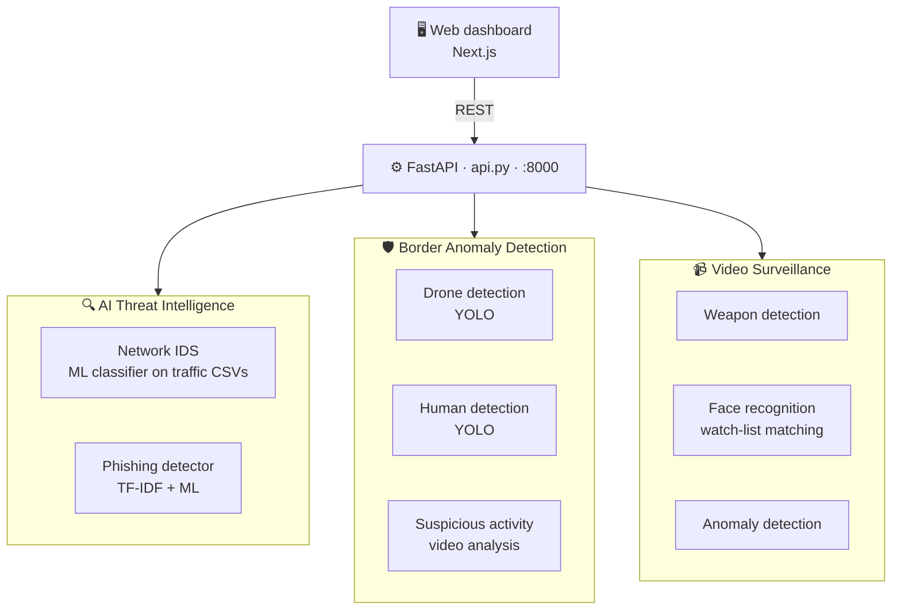

<!-- PakShield Defence AI · README by Usama Shahid (fewgets) -->
<div align="center">


<p>
  
  
  
  
  
  
</p>

<p>
  <a href="https://pak-shield-ai.vercel.app"><b>🌐 Live Demo</b></a> · <a href="https://github.com/fewgets/PakShieldAI-Website"><b>🖥️ Web Dashboard</b></a>
</p>

</div>

---
## 📌 Overview

**PakShield Defence AI** is an AI-powered **cyber-defence and surveillance platform** built for the
**Uraan Pakistan National Hackathon (Phase 2)**. It brings three intelligence modules together behind
one **FastAPI** backend:

| | Module | What it protects against |
|:-:|---|---|
| 🔍 | **AI Threat Intelligence** | Phishing emails and network intrusions |
| 🛡️ | **Border Anomaly Detection** | Unauthorised drones, human intrusion, suspicious movement |
| 📹 | **Video Surveillance AI** | Weapons, known faces on a watch-list, abnormal activity |

A companion **[Next.js web dashboard](https://github.com/fewgets/PakShieldAI-Website)** gives operators
a single command centre for all modules.

> 🌐 **Live dashboard:** [pak-shield-ai.vercel.app](https://pak-shield-ai.vercel.app)

---

## 🏗️ Architecture



---

## ✨ Capabilities

### 🔍 AI Threat Intelligence
- **Network Intrusion Detection (IDS):** upload network-traffic CSVs and get each flow classified as normal or attack, using a trained model with its scaler and label encoder.
- **Phishing Email Detection:** a TF-IDF + machine-learning classifier flags phishing emails.
- Training notebooks are included: `Network_Intrusion_Detection.ipynb` and `Phishing_Model_Training.ipynb`.

### 🛡️ Border Anomaly Detection
- **Drone detection:** a YOLO model spots drones (and tells them apart from birds) in images and video.
- **Human detection:** flags people entering restricted border zones.
- **Suspicious activity:** analyses video for unusual movement patterns and saves annotated output.

### 📹 Video Surveillance AI
- **Weapon detection:** recognises firearms in images and video.
- **Face recognition:** matches faces against a watch-list of known people.
- **Anomaly detection:** detects abnormal behaviour in surveillance footage.

Every detection is saved with an **annotated image or video** and a **JSON log**, ready for review.

---

## 🔌 API Reference

| Method | Endpoint | Module |
|---|---|---|
| `GET` | `/health` | Service health |
| `GET` | `/email-classify` | Phishing email classification |
| `POST` | `/ids-predict` | Network intrusion detection (CSV upload) |
| `POST` | `/border/drones/detect` | Drone detection |
| `POST` | `/border/humans/detect` | Human intrusion detection |
| `POST` | `/border/suspicious/detect` | Suspicious activity in video |
| `POST` | `/surveillance/weapon/detect` | Weapon detection |
| `POST` | `/surveillance/face/recognize` | Face recognition |
| `POST` | `/surveillance/anomaly/detect` | Anomaly detection |
| `GET` | `/border/files/{category}/{filename}` | Download annotated results |

Interactive docs: **http://localhost:8000/docs**

---

## 🚀 Run Locally

```bash
git clone https://github.com/fewgets/PakShield_Defence_AI.git
cd PakShield_Defence_AI

python -m venv venv
venv\Scripts\activate            # macOS / Linux: source venv/bin/activate
```

Install the dependencies for the modules you need:

```bash
pip install -r Backend/BorderAnomly/requirements.txt
pip install -r Backend/Survilleance/requirements.txt
pip install fastapi uvicorn python-multipart scikit-learn pandas
```

**Download the drone model.** `best.pt` is too large for GitHub:
📥 [Google Drive folder](https://drive.google.com/drive/folders/1ij55ZdL8atJGVm1cakVKcxjZ3jSrcuab?usp=sharing) → place it at `Backend/BorderAnomly/drones/best.pt`.

Start the API:

```bash
python api.py          # serves on http://localhost:8000
```

Then run the **[web dashboard](https://github.com/fewgets/PakShieldAI-Website)** and point it at `http://localhost:8000`.

---

## 📁 Project Structure

```text
PakShield_Defence_AI/
├── api.py                         # FastAPI gateway for all modules
├── Backend/
│   ├── AIThreatIntelligence/      # IDS + phishing models, training notebooks
│   ├── BorderAnomly/              # drones/ · HUMAN_DETECTION/ · suspicious activity
│   └── Survilleance/              # weapon · face recognition · anomaly detection
└── Frontend/                      # Web dashboard (see PakShieldAI-Website)
```

---

## 🧰 Tech Stack

| Category | Technologies |
|---|---|
| Backend | Python, FastAPI, Uvicorn |
| Computer Vision | OpenCV, YOLO (Ultralytics), PyTorch |
| Machine Learning | scikit-learn, Pandas, NumPy, TF-IDF |
| Frontend | Next.js 15, React 19, Tailwind CSS ([separate repo](https://github.com/fewgets/PakShieldAI-Website)) |

---

## 🎯 Use Cases

🛂 Border surveillance · 🪖 Military base perimeter security · 🚁 Restricted airspace monitoring ·
🔫 Weapon threat detection · 🏙️ Smart-city public safety · 🏭 Critical infrastructure protection

## 🔭 Roadmap

- [ ] Multi-camera distributed monitoring
- [ ] Thermal imaging and ANPR (number-plate recognition)
- [ ] Predictive threat analytics
- [ ] Mobile alerts for field teams

> ⚠️ Built for research, education and innovation. Contact me before any commercial or operational defence deployment.

---

## 🤝 Let's Work Together

<div align="center">

**Have an idea, a freelance project, or want to collaborate on something in AI?**
I'm always open to collaborations, freelance work and full-time opportunities.

<a href="mailto:shaikhusama541@gmail.com?subject=Collaboration%20-%20PakShield%20Defence%20AI">
  
</a>
<a href="https://www.linkedin.com/in/-usamashahid/">
  
</a>
<a href="https://github.com/fewgets">
  
</a>

<br/><br/>

⭐ **If you like this project, please give it a star. It really helps!** ⭐

<br/>

<h3>"Defending a nation starts with seeing threats before they arrive."</h3>


</div>
